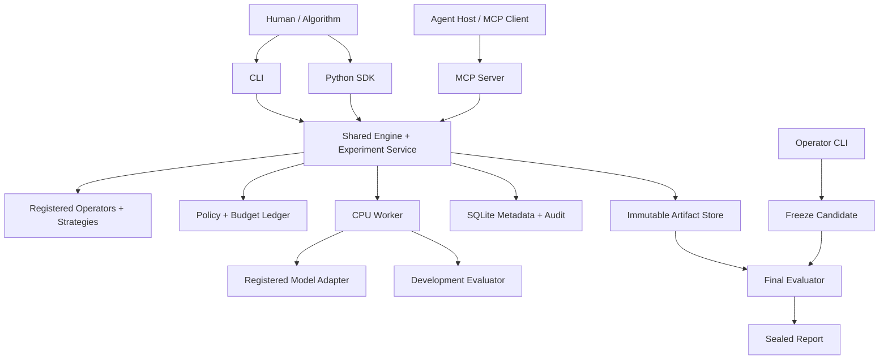

# Weight-Space Engineering Framework — Initial Implementation Plan

> **For agentic workers:** Use the `subagent-driven-development` skill during implementation, delivering and reviewing one task at a time. Track execution with the checkboxes below. M1 (Tasks 1–7) is complete, as the status paragraph below records.

**Goal:** Establish a reusable foundation for weight-space engineering, allowing humans, algorithms, and AI agents to inspect, transform, and evaluate model weights through shared contracts. Deliver the first complete workflow on a small model through Python, CLI, and MCP interfaces.

**Architecture:** A Python library defines model, operator, edit, evaluator, strategy, and experiment contracts. Core functions work in memory; an optional managed Engine and Experiment Service add persistence, budgets, and workers, with CLI and MCP as interface adapters. Immutable artifacts and evaluation records bind every managed candidate to exact inputs, method versions, and execution configurations.

**Tech Stack:** Python 3.11+, official MCP Python SDK 2.3.0, PyTorch, NumPy, Pydantic, safetensors, SQLite, and pytest. The M1 reference agent uses OpenAI Agents SDK for Python as an optional dependency; Claude Agent SDK follows in M2. Start with local stdio, then add remote GPU Workers and Streamable HTTP.

**Date and status:** Created 2026-11-03; direction and agent selection revised 2026-11-04, followed the same day by corrections to tool naming, response limits, task ordering, trial isolation, and interval reporting, and by decisions on the final-evaluation control, the Task 6 MCP host, and adapter aliases; after Tasks 4–6, previews became a metered quantity and run-facing views stopped exposing unmetered weight access. The user selected an end-to-end loop on small models as the first phase, a general weight-engineering framework as the long-term objective, and OpenAI Agents SDK for Python as the first reference agent, followed by Claude Agent SDK. Read the [framework vision](./weight-space-engineering-vision.md) alongside this plan and the [article summary](./weight-space-programming-summary.md). Target-model hardware remains unspecified, so M1 uses CPU execution. The concrete agent model, credentials, and agent SDK versions remain implementation configuration. Recheck compatibility and lock dependencies during implementation. Development uses uv and Git; the repository has had a GitHub remote since 2026-11-09. M1 closed on 2026-11-09. Tasks 1–7 are implemented and checked off below, and the four advancing conditions in Section 10 hold. The [M1 agent-trial report](m1-agent-trials.md) covers the acceptance set, in which all 5 trials met the target. The open items listed in that report carry over to the M2 plan.

## Global Constraints

- The first delivery must complete this loop on a small model: inspect → hypothesize → edit → evaluate → select/roll back → export a report.
- The MVP supports one local user, CPU execution, and explicitly registered small FP32 MLPs. It requires neither a GPU nor third-party model downloads.
- Agent changes can only create new versions; they cannot overwrite the original checkpoint, evaluator, or task definition.
- The initial managed benchmark policies expose no arbitrary Python, shell, gradients, optimizers, model training, or arbitrary code-loading tools to agents. These are M1 policy restrictions; future explicitly configured research methods may use broader capabilities.
- Core contracts and services must work through the Python SDK without MCP. CLI and MCP must invoke the same operation, budget, versioning, and evaluation semantics.
- OpenAI Agents SDK and Claude Agent SDK are optional controller dependencies. Core modules must not import them or expose their types in domain contracts.
- Models, operators, evaluators, and strategies are registered extensions. M1 implementations are concrete and minimal; no universal architecture mapping or automatic cross-model patch transfer is assumed.
- Every managed model computation entry point is governed by the experiment policy. Budgets, versions, and audit state persist independently of the MCP connection. Direct-library use is explicitly outside managed enforcement.
- Development feedback is isolated from the final blind evaluation. Once the final candidate is frozen, the result of that evaluation cannot guide further selection or editing within that trial.
- Verify toolchain correctness separately from the agent's ability to improve model metrics. Repairing synthetic faults is not evidence of general capability improvement.

## 1. Approach Selection and First-Phase Scope

| Approach | Benefits | Costs | Decision |
| --- | --- | --- | --- |
| **Small models + declarative operations + a complete experimental loop** | Validatable on CPU, easy fault localization, exact replay of changes | Initially limited operation set | **Adopt; deliver the MVP first** |
| Expose a Python notebook for direct weight editing | Flexible; supports exploration of complex algorithms | Harder execution isolation, budget enforcement, and reproduction | Provide the SDK in M1; introduce broader custom-code research execution under an explicit later policy |
| Connect an LLM immediately and reproduce the article's math experiment | Closer to the intended application | Introduces inference cost, model adaptation, and evaluation differences simultaneously | Proceed after the small-model loop is stable |

The MVP is a Python weight-engineering library with a managed experiment runtime, CLI, MCP interface, and reference agent runner. Humans, algorithms, and agents use the same domain operations. A strategy chooses hypotheses and operations; the runtime validates, executes, meters, and preserves evidence.

This phase excludes a multi-tenant platform, web console, distributed training, model merging, direct editing of quantized weights, and architecture search. These are sequencing decisions, not permanent limits on the research direction.

### 1.1 Framework Direction and Extension Contracts

The foundational goal is broader than reproducing the original article. Establish reusable abstractions for model interventions, with the small-model experiment serving as the first concrete implementation. The [framework vision](./weight-space-engineering-vision.md) describes the intended users, outputs, and adoption evidence.

The core primitives are `ModelAdapter`, `Operator`, `Edit`, `Evaluator`, `Strategy`, and `Experiment`. `PatchSpec` and `PatchPreview` implement the initial declarative `Edit` representation. `ObjectiveSpec` binds a natural-language goal to task-defined metrics, thresholds, and allowed regressions.

- A `ModelAdapter` advertises supported capabilities and axis/sharing semantics. Tensor access does not imply support for attention probes, layer surgery, quantization, or arbitrary architectures.
- An `OperatorSpec` identifies an operation by ID and version, input/output schemas, required capabilities, effect category (analysis/probe/edit), and usage accounting. The engine dispatches registered implementations; MCP handlers do not contain operator-specific algorithms.
- A `Strategy` proposes registered operations or stops, using the objective and permitted observations. Stepwise strategies use `next_action`; controllers with a complete SDK tool loop use the separate `AgentAdapter.run` integration contract. Both use the same experiment service and cannot alter the evaluator or their run grant.
- An `Evaluator` defines data access, metrics, and scoring. Strategies consume development feedback; final evaluation follows the existing freeze protocol.
- Registration is performed by the operator, with compatibility validation. Agents invoke permitted extensions; they do not install arbitrary plugins through MCP.

M1 uses a small in-process registry with explicit registrations. Dynamic plugin discovery, a remote registry, and a general computation graph compiler are unnecessary for this milestone. Built-in set/scale operations exercise the extension contract without defining a permanent limit on available methods.

An exact patch is specific to its base revision. An editing recipe can be reused only when a target adapter satisfies its requirements, and it needs fresh evaluation. Multiple model families on PyTorch demonstrate architectural extensibility; backend portability requires a separately implemented backend and is not an M1 claim.

### 1.2 Direct Library Use and Managed Experiments

Basic use must not require a running service or database. Proposed core interfaces are `load_model(source, adapter, config) -> ModelHandle`, `apply_operator(model, operator_id, parameters) -> EditResult`, and `evaluate_candidate(model, evaluator, config) -> EvaluationResult`. `ModelHandle` carries content identity and adapter metadata; `EditResult` contains the immutable candidate, materialized patch, and diff; `EvaluationResult` contains metrics, input/config identities, and observed usage. These are data objects without experiment IDs or persistence requirements.

The managed service wraps these same implementations, assigns artifact/report IDs, enforces policies, and commits records. An algorithm can use the direct functions in a notebook or run through `Experiment` when it needs enforcement and recovery. Direct use is labeled unmanaged; it cannot establish a verified no-forward or fixed-budget claim. This distinction must appear in exported result metadata.

### 1.3 Accepted Agent SDK Selection

Use **OpenAI Agents SDK for Python** for the M1 reference agent. Add **Claude Agent SDK** in M2 to verify reuse across agent runtimes. Keep both behind optional adapters; WSE remains usable through direct Python, scripted strategies, and other MCP clients.

The OpenAI integration uses the SDK's agent/tool loop and local stdio MCP connection. It exposes only the permitted WSE tools in the initial benchmark profile. By default the SDK forwards MCP tool names verbatim as model function names, shows the model the text content of tool results rather than `structuredContent` (`use_structured_content=False`), and exposes MCP resources only to application code; Sections 4.1 and 4.2 constrain tool names and result contents accordingly. The SDK handles conversation and model invocation; all weight operations, job scheduling, budget checks, candidate selection, and evaluation remain in WSE. This follows the application-owned runtime and local MCP integration described in the [Agents SDK guide](https://developers.openai.com/api/docs/guides/agents/sdk) and [MCP integration guide](https://developers.openai.com/api/docs/guides/agents/integrations-observability).

Define a vendor-neutral `AgentAdapter` with `run(experiment_id, agent_config, event_sink) -> AgentRunResult` and `cancel(experiment_id)`. `AgentRunResult` contains a termination status/reason, final message, optional conversation reference, usage, and provider metadata. It does not select a checkpoint or close the experiment. The runner reads authoritative state from WSE, settles outstanding jobs, and applies the freeze protocol after the SDK exits.

The runner persists the experiment before starting the adapter. Pass the same workspace/database location and run grant explicitly to the stdio server subprocess. The MCP server process is the sole job-scheduler owner for the reference agent run; the outer runner must not start a second scheduler. The runner manages the adapter's lifecycle so the MCP connection and server remain alive after the SDK loop returns, until pending work is settled and the experiment is frozen. On unexpected server loss, complete WSE recovery before attempting finalization. Reconnection refreshes state from WSE, and SDK conversation resume never resets the experiment budget.

Set initial controller limits to 100 SDK turns and 900 seconds of wall time per trial, independently of WSE's 300-second computation budget. Pass `max_turns=100` explicitly, because the SDK default is 10. These are configurable pilot limits, not expected task costs. The adapter records the terminal reason, propagates cancellation to the SDK, and asks WSE to cancel or drain active jobs before freezing. Observed stop conditions and budget errors must terminate the controller rather than let it repeatedly request denied work.

Plan optional extras `agents-openai` (`openai-agents`) and, in M2, `agents-claude` (`claude-agent-sdk`). Their imports live inside the corresponding adapter modules. Installation of the base package and its core tests must succeed without either extra. Benchmark runs disable SDK tracing (`RunConfig(tracing_disabled=True)`), because the SDK enables tracing by default, includes tool inputs and outputs, and exports traces to `api.openai.com`; the export metadata records the tracing setting. Where tracing is enabled outside benchmark runs, SDK-level traces are supplemental; WSE audit records and the budget ledger remain authoritative.

The Claude adapter must preserve the same task, tool permissions, budget accounting, and report formats. Verify its actual tool/configuration controls during integration rather than equating SDK option names. See the [Claude Agent SDK overview](https://code.claude.com/docs/en/agent-sdk/overview). This decision adds no implementation code or live API calls to the current documentation deliverable.

## 2. System Boundaries



Module responsibilities:

| Module | Responsible for | Not responsible for |
| --- | --- | --- |
| Python SDK / Engine | Shared public contracts, capability checks, operation dispatch, and access to experiment services | Depending on an MCP connection or a specific agent vendor |
| MCP Server | Schemas, tool discovery, resource reads, and error mapping | Storing experiment state in a connection |
| Experiment Service | Experiment state machine, object ownership, idempotency, commits, and candidate selection | Allowing agents to raise their own budgets |
| Model Adapter | Architecture, parameter names, axis semantics, and controlled inference | Executing unfamiliar code at the direction of a model repository |
| Extension Registry | Versioned operators, strategies, adapters, and evaluators with explicit compatibility requirements | Treating every architecture or operation as interchangeable |
| Patch Engine | Validation, numerical transformations, diffs, and new checkpoints | Deciding whether an edit improves capability |
| Evaluation Worker | Inference with fixed configurations, metrics, and resource metering | Changing the evaluation protocol in response to scores |
| Artifact Store | Content hashes and read-only access for weights, patches, dataset manifests, and reports | Implicitly referring to a mutable “latest model” |
| Agent Adapter | Running the selected SDK's conversation/tool loop, reporting usage/events, and propagating cancellation | Owning weight versions, evaluation results, or experiment budgets |
| Reference Runner | Driving scripted strategies or starting an SDK adapter; collecting records and finalizing experiments | Running a second tool loop around the SDK, modifying server budgets, or reading final answers |

MCP provides interfaces and communication. The services above must implement sandboxing, budget enforcement, atomic weight commits, and evaluation isolation; tool descriptions and annotations such as `readOnlyHint` cannot enforce them. See the [MCP specification](https://modelcontextprotocol.io/specification/2026-07-28).

## 3. Define Data Contracts First

All IDs are opaque strings generated by the server. Models and reports include `schema_version`; parameter ordering must not depend on Python dictionary insertion order. These are application-level contracts, independent of MCP transports or sessions.

| Object | Required contents |
| --- | --- |
| `ObjectiveSpec` | Task ID, behavioral objective, acceptance metrics/thresholds, and permitted regression thresholds |
| `OperatorSpec` | Operation ID/version, input/output schemas, required capabilities, effect category, and usage-accounting contract |
| `ModelManifest` | `checkpoint_id`, weight content hash, architecture adapter/version, configuration hash, tensor names/shapes/dtypes/axis semantics, input/output semantics, alias groups, provenance, and license |
| `Experiment` | `experiment_id`, `run_id`, `task_id`, immutable `policy_id` (including mode), `base_checkpoint_id`, `selected_checkpoint_id`, state, budget ledger, and creation/end timestamps |
| `PatchSpec` | Base checkpoint/hash, ordered operations, a brief hypothesis, expected behavior, and the intended development suite |
| `PatchPreview` | `patch_id`, spec hash, before/after hashes for each tensor, count of actually changed elements, L2/max-abs delta, finite-value checks, and storage cost |
| `EvaluationReport` | `report_id`, checkpoint/data/evaluator/config hashes, split, random seeds, sample count, metrics, time/memory, usage, errors, and truncation counts |
| `Job` | `job_id`, experiment/checkpoint/config, state, reservation, progress, actual usage, and a report or error |

Model identity includes both architecture and weights. The LLM phase also adds tokenizer, chat template, and generation configuration hashes. Comparing filenames or hashing only `.safetensors` is insufficient to establish identical behavior.

Each experiment records its strategy ID/version and configuration; each operation record resolves to an immutable operator ID/version. The public `op` aliases in this plan map to registered versioned implementations. Adapter references follow the same rule: an adapter ID without a version, such as `mlp`, resolves only through an alias the operator declares in the registry (the built-in registry maps `mlp` to `mlp@1`), never to the latest registered version, and manifests, handles, and patches record the resolved exact reference. Re-running a recipe rejects missing or incompatible implementations instead of silently substituting the latest version. Applying a materialized exact patch uses its stored changes and base/result hashes, without executing the original editing plugin.

Only `READY` managed checkpoints may be listed or loaded through experiment interfaces; direct-library handles do not participate in the database state machine. The small-model MVP saves complete new snapshots; the large-model phase uses a base plus tensor/block patches, with explicit materialization. Count changes as **elements that actually differ after writing back to the original dtype**. Also report the total parameter count and absolute/relative perturbation, so a small edit fraction is not equated with a small behavioral effect.

## 4. Public MCP Interface

The MCP interface below is one front end to the Python library. The SDK exposes the same service operations as Python calls, and the CLI uses that API. All managed entry points share grants, capability checks, reservations, and artifacts. The domain layer must not import MCP request types or require transport state.

### 4.1 Tool Set

The M1 server registers the following tools. Tool names use only letters, digits, `_`, and `-`, with at most 64 characters: OpenAI Agents SDK forwards MCP tool names verbatim as model function names, and the Chat Completions function-name rule excludes `.`. Every tool within an experiment checks object ownership. Every mutation tool requires an `idempotency_key`: the same key and input return the same result without creating another version or charging the budget again; the same key with different input returns a conflict.

| Tool | Main inputs | Output and constraints |
| --- | --- | --- |
| `wse_list_models` | Pagination cursor | Registered model summaries; does not scan arbitrary filesystem paths |
| `wse_create_experiment` | `run_id, task_id, policy_id, idempotency_key` | An experiment; an operator-issued run grant restricts task/policy and permits at most one experiment per run |
| `wse_get_experiment` | `experiment_id` | State, task definition and `ObjectiveSpec`, selected version, remaining budget, available operations, and suites |
| `wse_inspect_model` | `experiment_id, checkpoint_id` | Manifest and parameter statistics by layer; the statistics are charged as compute time |
| `wse_read_tensor` | The IDs above, `tensor, selection` | A bounded slice of at most 2,048 elements within the response-size rule below; oversized requests return an error stating the largest permitted selection |
| `wse_analyze` | The IDs above, `kind, tensor, selection`, optional `k` | MVP: stats/norm/top-k only; M2 adds SVD, weight-matrix products, and direction analysis |
| `wse_preview_patch` | `experiment_id, patch_spec, idempotency_key` | Saves an immutable preview and `patch_id` without switching the current model; each new preview charges one patch preview |
| `wse_apply_patch` | `experiment_id, patch_id, idempotency_key` | Creates a candidate checkpoint from the validated preview |
| `wse_submit_evaluation` | `experiment_id, checkpoint_id, suite_id, eval_config, idempotency_key` | Returns `job_id` immediately; development suites only |
| `wse_get_job` | `experiment_id, job_id, wait_seconds=0` | queued/running/succeeded/failed/cancelled, progress, the report summary (metrics, sample count, errors) inline, and report references; `wait_seconds` (0–10) holds the call until the job is terminal or the wait expires, so polling does not consume agent turns |
| `wse_cancel_job` | The IDs above, `idempotency_key` | Requests a stop; computation already performed remains charged |
| `wse_compare` | `experiment_id, base_report_id, candidate_report_id` | Paired differences and intervals; rejects comparisons with mismatched configurations or samples |
| `wse_select_checkpoint` | `experiment_id, checkpoint_id, expected_selected_id, idempotency_key` | Updates the selected version using CAS; selecting an ancestor performs a rollback |

`selection` is a list of `start/stop/step` specifications, one per axis. The MVP accepts only nonnegative, nonempty, in-bounds contiguous slices with step 1. Tensor names require exact matches; Python expressions are rejected. stats returns count/mean/std/min/max/nonfinite_count, with population standard deviation (ddof=0); norm returns L1/L2/Linf; top-k returns indices and values sorted by descending absolute value and then ascending flattened index for ties. An explicit `k` must satisfy `1 ≤ k ≤ min(64, element_count)`; an omitted `k` resolves to `min(16, element_count)`, so default calls also succeed on tensors with fewer than 16 elements, such as every tensor of the signed-sum fixture. Other kinds do not use k.

Values are serialized as JSON numbers in the shortest representation that round-trips the stored dtype; for FP32 this is NumPy's float32 representation, not the float64 text produced by `.tolist()`. The canonical compact JSON of a read or analysis result must not exceed 31 KiB (32 KiB less a 1 KiB allowance for the response envelope and JSON-RPC framing), because the MCP response carries it twice, as `structuredContent` and as the text mirror that OpenAI Agents SDK shows the model by default; the complete response must stay within 64 KiB. Without the allowance, a 32 KiB result measured 66,719 bytes on the wire; with it, the largest permitted read of worst-case values measured 64,842 bytes, about 700 bytes under the limit. Measured for 2,048 FP32 values: 25.2 KiB for N(0, 0.02) weights, 30.0 KiB when every value needs 14 characters, and 44.7 KiB with `.tolist()`. A request that would exceed the limit returns an actionable error stating the largest permitted selection.

The MVP fields of `eval_config` are `sample_count, seed`. Only sample slices and seeds preregistered in the suite manifest are accepted; the server fixes the execution device and batch size. The LLM phase adds preregistered sampling profiles so agents cannot silently change decoding settings during comparisons.

The Operator CLI handles model import, policy registration, run grants, final freezing, and exports. Agents need neither filesystem path permissions nor arbitrary download access; they may reference only registered objects authorized for that run. The first CLI is planned to provide `wse import`, `wse grant-run`, `wse serve`, `wse freeze`, `wse final-evaluate`, and `wse export`.

A local stdio server process is bound to a persisted run grant; the run_id supplied by the client must match it. The server atomically limits each run to one experiment. Retries return the existing experiment; changing task/policy or the idempotency key cannot reset the quota. Restarting does not restore consumed allowance. Model listings, resources, and every experimental tool can access only objects permitted by the grant, excluding candidates and feedback from other trials. A run-bound Python Engine follows the same rules and reaches weights only through metered experiment operations; it cannot open a checkpoint handle, whose tensors and `forward` are unmetered.

### 4.2 Resources and Return Formats

Resource URIs are `wse://models/{checkpoint_id}/manifest`, `wse://experiments/{experiment_id}/policy`, `wse://reports/{report_id}`, `wse://patches/{patch_id}`, and `wse://analyses/{digest}` (large analysis results, readable only by the run whose experiment produced them). Reads and tools use the same authorization checks; final reports are withheld from the agent until the experiment closes. A patch resource omits the materialized after-values, because with a known factor they reproduce base weights; the exact patch is an operator view for replay and export. Large artifacts return summaries inline plus URIs. Resource reads are also paginated and bounded so they cannot bypass slice-size limits. A benchmark agent must be able to complete a trial through tools alone, because OpenAI Agents SDK exposes MCP resources only to application code. Tool results therefore carry inline everything the agent needs (task and objective, manifests, patch previews, and report metrics), and resources remain an optional view for hosts that surface them.

Tools declare input/output JSON Schema. Successful output includes object IDs, a summary, artifact URIs, and per-call/cumulative usage. Domain errors contain `code, message, retryable, details` and are returned as MCP tool errors. Define at least `NOT_FOUND`, `POLICY_DENIED`, `INVALID_PATCH`, `BUDGET_EXCEEDED`, `VERSION_CONFLICT`, `IDEMPOTENCY_CONFLICT`, `INCOMPATIBLE_REPORTS`, and `WORKER_FAILED`.

Python SDK v2 uses `structured_content` and `output_schema` internally; wire fields remain `structuredContent` and `outputSchema`. Map domain failures to `ToolError` and handle protocol errors separately. See [structured output](https://py.sdk.modelcontextprotocol.io/servers/structured-output/) and [error handling](https://py.sdk.modelcontextprotocol.io/servers/handling-errors/).

### 4.3 Protocol and Long-Running Tasks

Use MCP **2026-07-28** and Python SDK **2.3.0**, with SDK v2's `MCPServer`; the minimum Python version is 3.11. The current protocol uses self-contained requests. Do not use the old `initialize` handshake or transport sessions as containers for experiment state. Delegate legacy Host compatibility to the SDK and test actual connections separately. See [SDK releases](https://github.com/modelcontextprotocol/python-sdk/releases), [installation requirements](https://py.sdk.modelcontextprotocol.io/get-started/installation/), and [v2 changes](https://github.com/modelcontextprotocol/python-sdk/blob/main/docs/whats-new.md).

The MVP MCP adapter uses stdio and writes logs to stderr. The remote phase uses Streamable HTTP; do not introduce the old HTTP+SSE transport. Start with application-level job tools for long-running work, without assuming that the Host supports native Tasks. Tasks is currently the optional `io.modelcontextprotocol/tasks` extension, which can be supported later. Cancelling a request does not mean a GPU kernel has terminated; workers must implement stopping and usage settlement themselves. See [transports](https://modelcontextprotocol.io/specification/2026-07-28/basic/transports), the [Tasks extension](https://modelcontextprotocol.io/extensions/tasks/overview), and [cancellation semantics](https://py.sdk.modelcontextprotocol.io/handlers/cancellation/).

## 5. Weight-Editing Semantics and Version Management

### 5.1 MVP Operations

Register these as versioned built-in operators. Agent-facing patches remain declarative; implementations use the shared operator interface so later algorithms do not require new storage or transport code.

- `set_slice`: Replace an explicit slice with supplied values. Shapes must match exactly; no implicit broadcasting.
- `scale_slice`: Multiply a slice by a finite scalar while preserving shape/dtype. Record no-op changes, but do not count them as changed elements.
- A patch may contain multiple operations, applied in list order to the same candidate snapshot. Check finite values and shapes after every step and in the final result. If any step fails, commit none of the patch.

The following example is a `patch_spec` tool input for a hypothetical 8-input MLP. Documentation, tool descriptions, and schema examples always use a model and task other than any agent-trial fixture, so no example can reveal a trial's answer. Its checkpoint ID illustrates the contract; actual IDs are returned by tools at runtime:

```json
{
  "base_checkpoint_id": "ckpt_example_base",
  "hypothesis": "Hidden unit 3 dominates the output for inputs outside the training range.",
  "expected_behavior": "Halve that unit's input weights while keeping development accuracy unchanged.",
  "development_suite_id": "example_dev_v1",
  "operations": [
    {
      "op": "scale_slice",
      "tensor": "layers.0.weight",
      "selection": [{"start": 3, "stop": 4, "step": 1}, {"start": 0, "stop": 8, "step": 1}],
      "factor": 0.5
    }
  ]
}
```

The server resolves the base content hash from the immutable checkpoint and writes it into the frozen spec; it must not trust a client-supplied hash. Operations cannot be replaced between preview and apply; apply accepts only `patch_id`.

### 5.2 M2 Extended Operations

Add `add_low_rank` and `project_out`. PyTorch Linear stores weights as `[out_features, in_features]`; the adapter must explicitly identify input and output axes rather than infer them from names. [PyTorch Linear](https://docs.pytorch.org/docs/2.15/generated/torch.nn.Linear.html)

- Low-rank increment: `W' = W + αUVᵀ`, with `U:[out,r]` and `V:[in,r]`. Default to `r ≤ 16` and reject dimension mismatches.
- Remove an output direction: for selected columns `C`, use `W'[:, C] = W[:, C] - α d(dᵀW[:, C])/(dᵀd)`. Require `d:[out]` and a norm above the policy threshold. Input-direction projection is a separate operation and must not be confused with this one.
- Compute edits in FP32, then cast back to the original dtype. Write only the specified region and preserve the original bytes outside it. Record the actual patch after rounding.
- Represent parameter sharing through manifest alias groups. The MVP rejects models with shared parameters. M2 supports tied embeddings only after defining whole-group updates and serialization/restoration behavior.

### 5.3 Commit, Rollback, and Recovery

1. Generate the complete candidate, diff, and hashes in a temporary directory, checking resource limits.
2. Write and sync content files, then publish them to immutable artifact paths with atomic rename.
3. In one SQLite transaction, write artifact metadata, checkpoint READY state, audit events, and the idempotent result. A file that exists before its database commit is merely an invisible orphan.
4. On startup, recovery scans remove expired temporary files and unreferenced artifacts. If the database points to a missing file or a hash mismatch, mark it corrupt and prohibit loading.
5. Select candidates using compare-and-swap; explicitly reject concurrent selection conflicts. Rollback changes only the selected ID, without deleting history or refunding consumed budget.

The filesystem and SQLite do not share a transaction. Visibility depends on READY metadata, and crash recovery depends on the sequence above. Replaying a patch must reproduce identical tensor byte hashes. Statistical metrics from stochastic computations across platforms may be compared within documented tolerances.

## 6. Experimental Constraints, Budgets, and Execution Isolation

### 6.1 Experimental Modes

| Mode | Visible information | Computation permissions | Phase |
| --- | --- | --- | --- |
| `weights_only` | Architecture, task semantics, weight summaries, and slices | No target-network forward passes; listed parameter analyses and edits are allowed | MVP |
| `bounded_eval` | The above plus development evaluation feedback | Controlled inference within a fixed budget | MVP |
| `probe` | The above plus activation/attention summaries from specified layers | Every probe counts against the inference budget | M2 |
| `research_python` | Weights and an isolated programming environment | Custom algorithms with complete execution records | Separate later mode |

“Weights only” and “gradient free” are experimental protocols that require constraints on the entire Agent Host. Benchmark runs disable the agent's external shell, file access, and other inference entry points. Evaluator files, answers, and raw final datasets stay outside the agent's workspace. If a general client retains other execution channels, label its report `constraint_status=unverified`; do not claim a strict zero-forward setting. In the MVP, `torch.inference_mode()` only disables gradient recording and reduces inference overhead. It is not a sandbox or an enforcement mechanism for prohibiting training.

### 6.2 Budget Ledger

The main demo uses `small_model_v1` with `mode=bounded_eval`: at most **20 candidate commits, 50 patch previews, 50 tensor analyses, 100 slice reads, 10 development evaluation batches, 64 examples per batch, 640 examples total, 30 seconds per computation operation, and 300 seconds of computation per run**. Previews are counted because their L2 and max-abs deltas reveal the base values of the edited region: two previews of a single-element `set_slice` determine that weight exactly. Only one worker executes at a time. Computation time is the sum of elapsed time spent executing server operations, excluding queue waits. Also register `small_model_weights_only_v1` with `mode=weights_only`: evaluation batch/example/forward allowances are all 0 and candidate commits are limited to 1, so the server, not the runner, enforces the one-candidate protocol for every client; all other limits are unchanged. Mode is an immutable policy field and cannot be overridden by create_experiment. These are initial engineering limits, not claims about optimal research budgets.

Atomically reserve allowance in SQLite before queuing each computation. The MCP server (job scheduler), worker, and runner are separate processes that share the database, so each reservation is a single conditional `UPDATE` or runs inside `BEGIN IMMEDIATE`; Python's `sqlite3` opens no transaction before a `SELECT`, so a separate check-then-update can overallocate. Settle failures, cancellations, and timeouts according to work already executed. Release portions that have not started. For crashed jobs whose usage cannot be verified, conservatively charge the reservation and do not rerun automatically. Retrying the same idempotency key only retrieves the original result. Worker heartbeats and leases detect interruptions; after restart, settle them before accepting new jobs.

Record at least these separate quantities:

- `evaluation_batches`, `evaluated_examples`, `model_forward_calls`, and `compute_seconds`.
- `analysis_calls`, `tensor_read_calls`, `candidate_commits`, `patch_previews`, artifact bytes, and peak memory.
- Agent input/output tokens, provider/model/version, and cost. Fields unavailable from the Host must be `null` with an explanation, not zero.
- In the LLM phase, add prompt/generated tokens and prefill/decode counts; in the RL phase, add episodes/env steps.

Weight analysis, previews, and exports also need CPU, memory, and time limits. Artifacts may still be read after summaries are returned, but every read remains subject to authorization, quotas, and response-size limits. Enforce budgets consistently in the service/worker layer rather than charging only within individual MCP handlers.

### 6.3 Local and Remote Execution

The MVP uses an independent worker process, an explicit job queue, and a finite operator set; it does not execute agent-generated code. Models must consist of safetensors weights and a registered architecture. Validate shape, dtype, finite values, and file size on import. Safetensors supports tensor/slice reads and is a suitable weight-storage foundation, but does not replace architecture validation or resource limits. [safetensors documentation](https://huggingface.co/docs/safetensors/index)

When Python access is added, use a separate Linux container or VM with network, mount, CPU, memory, and duration limits. On macOS development machines, provide this environment through a Linux VM instead of assuming Linux sandbox tools run natively. Even with OS isolation, arbitrary NumPy/PyTorch programs can reimplement forward passes or optimizers, so the research constraints of `research_python` require auditing; it must not be presented as a strict mode.

The remote HTTP phase adds OAuth, token audience/scope validation, and object-level access control. Local stdio uses local process identity rather than an artificial HTTP login flow. [MCP authorization specification](https://modelcontextprotocol.io/specification/2026-07-28/basic/authorization)

## 7. First Demo and Acceptance Criteria

### 7.1 Controlled Task: Repair a Binary Classification MLP

Task definition: given input `x=(x0,x1)`, output class 1 when `x0+x1>0`, otherwise class 0. The model is an FP32 `2 → 4 (ReLU) → 2` network. In the clean fixture, the first layer computes four positive/negative directions, and the second layer produces the two class scores. All biases are zero.

```text
W1 = [[ 1, 0], [-1, 0], [0, 1], [0,-1]]
W2 = [[-1, 1, -1, 1], [1,-1, 1,-1]]
Fault: multiply row 1 of W2 (zero-indexed) by -1.
```

After the fault, the two rows are identical, so deterministic argmax selects class 0. Generate balanced data as pairs of `x,-x`, excluding `|x0+x1|<0.1`. Baseline accuracy should be 50%; restoring the row should yield 100%. This behavior can be verified analytically without training or external data.

The development set contains a fixed 64 examples. `task.json` declares `target_accuracy=1.0`, and the target is met only by a successful evaluation report covering all 64 examples. The final set contains 1,024 independently pregenerated examples; its contents and seed remain accessible only to the final evaluator. The agent can see the task definition, faulty model, and development feedback, but not the clean checkpoint, fault location, ideal patch, or fixture construction code in this section. The reference runner must isolate the source code and this plan document; a prompt asking the agent not to look at the answer is insufficient. Agent instructions are generated from `task.json` and the policy, never from repository documentation. Nothing the agent can observe (instructions, tool names, descriptions and schemas, or tool outputs including manifest `provenance`) may contain the clean checkpoint ID, the oracle patch, or a description of the injected fault; an automated leak test renders these surfaces for the signed-sum trial and checks them.

### 7.2 Two Levels of Acceptance

**Engineering acceptance (required):**

- Direct Python use completes load → operator → candidate → evaluation without MCP, SQLite, or a job service. Managed Python, CLI, and MCP paths produce the same materialized patch and bind reports to the same model/evaluator/configuration identities.
- Installing and importing the base package succeeds with both agent SDKs absent. Controller tests verify usage/event normalization, timeout/cancellation, and that SDK termination does not bypass WSE job settlement or freezing.
- A separately supplied operator registers through the extension contract without edits to core dispatch or MCP handlers. Unsupported adapter capabilities fail before candidate creation.
- A scripted MCP client completes create/inspect/read/preview/apply/evaluate/compare/select/rollback through the actual protocol, rather than calling services directly.
- An oracle patch restores this fixture from 50% to 100%; the original checkpoint hash remains unchanged; rollback restores 50% accuracy. The oracle is used only in engineering tests.
- Repeated idempotent requests create no duplicate candidates and incur no duplicate charges; concurrent budget requests cannot overallocate; a stale selected ID returns a conflict.
- Invalid shapes, nonfinite values, out-of-bounds slices, unknown tensors, exhausted budgets, and prohibited splits return actionable errors without partial mutations.
- History, budgets, and the selected checkpoint remain consistent after restart; orphaned artifacts from interrupted operations do not become available models.
- Evaluation is unavailable in `weights_only` mode; tests confirm that the worker never executes the target network.

**Agent acceptance (reported separately):**

- Run 5 independent trials with a fixed configuration of the chosen agent, each within the specified budget. The target is for at least 4/5 trials to find a candidate achieving ≥99% accuracy on the final set.
- If the target is missed, still publish complete failure traces and toolchain test results. Engineering completion must not be presented as validation of agent capability.
- Record candidate counts, evaluated examples, elapsed time, agent tokens, the proportion of parameters changed, and failure causes for every trial. This threshold is an acceptance target for a small demo, not a claim of general capability.

### 7.3 Evaluation Isolation and Controls

Experiment states are `OPEN → FROZEN → CLOSED`. In the MVP, freeze checks transactionally that no queued/running jobs or unsettled reservations remain. If any exist, it returns `VERSION_CONFLICT`; the runner waits for or cancels those operations, settles their usage, and retries. Freeze and new job submission use the same transactional experiment-state check to avoid races. After freezing, the selected checkpoint and development-tool outputs cannot change. Final evaluation is performed through the CLI or a separate role. It evaluates the frozen selected checkpoint and, as a fixed control, the experiment's immutable base checkpoint on the same final examples and configuration, and reports their paired difference with the intervals described below; when the frozen selection is the base checkpoint, one evaluation serves both. It accepts no other checkpoint. The experiment record fixes the control, so it adds no selection freedom, and every trial gets a same-sample baseline. The experiment closes after the final report is written. An agent-initiated finish can only request freezing, not invoke the final suite; the MVP reference runner performs freezing when the agent exits.

Each of the 5 agent trials uses a separate run grant and fresh context. Execute and publish final evaluations only after all trials have frozen, so later trials cannot adapt to earlier final feedback. Failed final evaluations may be retried on the same frozen candidate, but the candidate cannot change.

For subsequent research, include at least a baseline, a no-op patch, random perturbations matched for changed-element count and L2 norm, a human oracle where available, and agent conditions with and without dynamic feedback. Use 5 seeds for random controls and report every preregistered agent run. Repeated access to the same holdout contaminates candidate selection; subsequent experiments require new preregistered splits.

For classification, report accuracy and paired differences with cluster-bootstrap 95% intervals. The `x,-x` examples in this fixture are correlated, so clusters are the generated pairs; sample-level resampling is appropriate only for tasks with independent examples. At this fixture's 50% and 100% boundaries every pair has the same score (the faulty model gets exactly one example of each pair right, and a repair gets both), so the bootstrap interval collapses to zero width; also report an exact Clopper–Pearson 95% interval on the number of fully correct pairs. With 512 final pairs, 512/512 gives a lower bound of 99.28% and 511/512 gives 98.92%. Cluster episode tasks by episode and repeated LLM samples by question. Report separate cross-capability regression metrics and allowable degradation thresholds rather than only an aggregate score. Fix random seeds, dependencies, hardware, and sampling settings. PyTorch does not guarantee bitwise reproducibility across versions or devices, so distinguish byte-identical weight replay from metrics that agree within statistical tolerances. [PyTorch reproducibility guidance](https://docs.pytorch.org/docs/2.15/notes/randomness.html)

## 8. Planned Files and Modules

Every file below exists as of M1. The repository also contains supporting modules and tests that this list omits.

```text
pyproject.toml                  # Dependencies, wse CLI, pytest configuration
uv.lock                         # Versions resolved and locked during implementation
src/wse/
  api.py                        # Direct library functions and managed Engine facade
  registry.py                   # Explicit versioned extension registration
  schemas.py                    # Shared Pydantic contracts and error codes
  cli.py                        # Import, serve, freeze, final-evaluate, export
  mcp_server.py                 # Tools/resources and protocol mapping
  experiments.py               # State machine, idempotency, ownership, CAS selection
  policy.py                    # Operation, data, and resource restrictions
  budget.py                    # Atomic reservations and settlement
  store.py                     # Content-addressed artifacts, commit, and recovery
  database.py                  # SQLite schema, transactions, and migrations
  audit.py                     # Structured events and export
  analysis.py                  # Bounded tensor statistics
  patches.py                   # set_slice/scale_slice, preview/apply
  jobs.py                      # Job queue, leases, cancellation, and recovery
  worker.py                    # Separate-process execution, metering, and timeouts
  adapters/base.py             # ModelAdapter Protocol
  adapters/mlp.py              # Registered MLP architecture
  operators/base.py            # OperatorSpec and implementation contract
  operators/tensor.py          # Built-in analysis and set/scale operations
  strategies/base.py           # Objective/observation/action controller contract
  strategies/scripted.py       # Deterministic reference controller
  evaluators/classification.py # Metrics and reports
  agent_adapters/base.py       # Vendor-neutral run/cancel/results contract
  agent_adapters/openai_agents.py # M1 optional OpenAI Agents SDK integration
  runner.py                    # Controller selection, records, and experiment finalization
tests/
  test_api.py
  test_registry.py
  test_agent_adapter.py
  test_store.py
  test_analysis.py
  test_patches.py
  test_experiments.py
  test_budget_jobs.py
  test_evaluation.py
  test_mcp_e2e.py
  test_recovery.py
examples/signed_sum/
  build_fixture.py             # Operator/test use only
  task.json                    # Agent-visible task description
  policy.json                  # Fixed experiment policy
docs/protocol.md               # Tool contracts, errors, and example calls (non-trial models only)
docs/extensions.md             # Adapter/operator/evaluator/strategy contracts
docs/experiments.md            # Running experiments and interpreting results
```

Runtime outputs go to the configured `workspace/artifacts/`, `workspace/metadata.sqlite`, and `workspace/exports/`; the final dataset resides in separate evaluator storage. Actual weights, datasets, and credentials stay outside the source repository and its GitHub remote; commit only source, configuration, and documentation.

## 9. Implementation Tasks and Dependencies

Tasks run in order 1→2→3→4→5→6→7. Tasks 1–3 establish the core contracts. Task 5 depends on Task 4: freezing checks Task 4's jobs and reservations, parity with managed evaluation runs through Task 4's worker, and both tasks extend `schemas.py`. Task 6 integrates the system; Task 7 completes agent trials and delivery. The commands below are each task's acceptance checks; all of them passed when M1 closed.

### Task 1: Model Registration and Immutable Storage

**Files:** `pyproject.toml`, `uv.lock`, `src/wse/{api,registry,schemas,database,store,cli}.py`, `src/wse/adapters/{base,mlp}.py`, `tests/test_store.py`, `tests/test_api.py`, `tests/test_registry.py`, `examples/signed_sum/build_fixture.py`.

**Interfaces:** Core `load_model(source, adapter, config) -> ModelHandle`; managed `import_model(manifest, tensors) -> ModelManifest`, `load_manifest(checkpoint_id) -> ModelManifest`, and `read_tensor(checkpoint_id, tensor, selection) -> Tensor`. `ModelAdapter` provides `capabilities()`, `validate(manifest, tensors)`, and `forward(tensors, inputs) -> logits`; in managed experiments, only the worker may invoke forward. The registry provides `register(kind, extension_id, version, implementation)` and `resolve(kind, extension_id, version)` for explicit operator-controlled setup.

- [x] Lock dependencies and the CLI entry point; create the shared schemas and SQLite migration 1.
- [x] Define core handles/results, `ObjectiveSpec`, and the extension registry; verify an in-memory model load requires neither SQLite nor MCP and rejects unknown adapter versions.
- [x] First write fixture roundtrip tests: imported parameters are bitwise identical; invalid architectures/shapes, path escapes, and nonfinite values are rejected.
- [x] Implement content-addressed safetensors + manifest storage, READY visibility, and the minimal MLP adapter.
- [x] Verify that `uv run pytest tests/test_store.py tests/test_api.py tests/test_registry.py -q` passes; importing the same bundle again must not duplicate weights.
- [x] Review and save the deliverable; make a separate commit if Git is available.

### Task 2: Bounded Weight Reading and Analysis

**Files:** `src/wse/analysis.py`, `src/wse/policy.py`, `src/wse/operators/{base,tensor}.py`, `tests/test_analysis.py`; extend `schemas.py`, `registry.py`, and `tests/test_registry.py`.

**Interfaces:** `inspect(checkpoint_id) -> ModelManifest`; `analyze(checkpoint_id, kind, tensor, selection, k=None) -> AnalysisResult`, where an omitted `k` resolves as described in Section 4.1. `AnalysisResult` includes the operation, input hash, numerical results, and elapsed time; large results are referenced by artifact URI.

- [x] Write tests for slice boundaries, the 2,048-element limit, and the 32 KiB canonical-JSON limit; reject expressions and oversized top-k requests; confirm that default top-k succeeds on tensors with fewer than 16 elements.
- [x] Implement stats, norm, top-k, and a large-object response policy without implicit copying.
- [x] Register built-in analyses through `OperatorSpec`; test a separately supplied analysis implementation and a missing-capability rejection without changes to dispatch code.
- [x] Verify means, norms, and top-k indices using known matrices; confirm that none of these paths calls adapter.forward.
- [x] Verify that `uv run pytest tests/test_analysis.py -q` passes and review the deliverable.

### Task 3: Patches, Experiment State, and Rollback

**Files:** `src/wse/{patches,experiments,audit}.py`, `tests/{test_patches,test_experiments,test_recovery}.py`; extend `api.py`, `operators/tensor.py`, `store.py`, `database.py`, `schemas.py`, and `tests/test_api.py`.

**Interfaces:** `create_experiment(run_id, task_id, policy_id, key) -> Experiment`; `preview_patch(experiment_id, spec, key) -> PatchPreview`; `apply_patch(experiment_id, patch_id, key) -> ModelManifest`; `select_checkpoint(experiment_id, checkpoint_id, expected_selected_id, key) -> Experiment`.

The managed patch path uses core `apply_operator(model, operator_id, parameters) -> EditResult`. Both built-in and registered edit operators materialize changes in the standard patch representation, preserving operator versions as provenance.

- [x] Write known-value tests for set/scale, including a multi-operation patch whose later failure must produce no READY candidate.
- [x] Implement set/scale as registered edit operators; verify a direct in-memory edit and a managed edit yield the same changed tensor bytes, and replay of the materialized patch does not execute the editing plugin.
- [x] Implement frozen previews, immutable candidates, idempotency records, the single-experiment run-grant limit, object ownership, and CAS selection; test that recreating an experiment cannot reset its budget, that policy/mode changes are rejected, and that `apply_patch` enforces the policy's candidate-commit limit (1 under `small_model_weights_only_v1`).
- [x] Inject failures before and after file rename and database commit; verify restart recovery and unchanged original weights.
- [x] Verify that `uv run pytest tests/test_patches.py tests/test_experiments.py tests/test_recovery.py -q` passes; failures must remain traceable without affecting the selected checkpoint.
- [x] Review and save the deliverable.

### Task 4: Budgets, Asynchronous Workers, and Cancellation

**Files:** `src/wse/{budget,jobs,worker}.py`, `tests/test_budget_jobs.py`; extend `policy.py`, `database.py`, and `schemas.py`.

**Interfaces:** `reserve(experiment_id, job_id, requested_usage) -> Reservation`; `settle(reservation_id, actual_usage, terminal_state)`; `submit_evaluation(experiment_id, checkpoint_id, suite_id, config, key) -> Job`; `get_job(experiment_id, job_id, wait_seconds=0) -> Job`; `cancel_job(experiment_id, job_id, key) -> Job`.

- [x] First write concurrency tests: with one unit of budget remaining, only one of two requests on independent database connections can reserve it; repeated idempotent requests create only one job.
- [x] Implement atomic SQLite reservations, a single-worker queue, process time limits, heartbeats, cancellation, and settlement after crashes.
- [x] Cover cancellation while queued, while running, and after success, plus jobs lost during restart; confirm that cancellation does not refund consumed budget.
- [x] Verify that `uv run pytest tests/test_budget_jobs.py -q` passes and review the deliverable.

### Task 5: Development Evaluation, Freezing, and Final Evaluation

**Files:** `src/wse/evaluators/classification.py`, `tests/test_evaluation.py`, `examples/signed_sum/{task,policy}.json`; extend `api.py`, `cli.py`, `schemas.py`, `experiments.py`, and `tests/test_api.py`.

**Interfaces:** `evaluate(checkpoint_id, suite_id, config) -> EvaluationReport` (worker-internal only); `compare(base_report_id, candidate_report_id) -> ComparisonReport`; `freeze(experiment_id, expected_selected_id) -> Experiment`; `final_evaluate(experiment_id) -> FinalEvaluationReport` (operator only), containing the frozen candidate's report, the base-checkpoint control report, and their paired `ComparisonReport` (Section 7.3).

The worker invokes core `evaluate_candidate(model, evaluator, config) -> EvaluationResult`, then persists its bindings and usage as an `EvaluationReport`. Direct-library evaluations use the same evaluator without claiming managed enforcement.

- [x] Write exact tests for clean/broken/repaired models: 100%/50%/100% accuracy on the balanced fixture.
- [x] Complete the no-service Python acceptance path in `tests/test_api.py`; check metric and model/configuration identity parity with managed evaluation.
- [x] Implement development/final dataset manifests, task hashes, evaluation configurations, and paired comparisons; reject comparisons with mismatched configurations.
- [x] Test that no agent-facing service operation can read the final set (Task 6 repeats this through MCP tools and resources), that active jobs prevent freezing, frozen experiments cannot be edited or accept checkpoint selection or new jobs, failed final evaluations can be retried on the same frozen model, and the final report pairs the frozen candidate with the base-checkpoint control and accepts no other checkpoint.
- [x] Verify that `uv run pytest tests/test_evaluation.py -q` passes; produce machine-readable reports and concise Markdown reports.
- [x] Review and save the deliverable.

### Task 6: MCP Integration and Protocol-Level End-to-End Tests

**Files:** `src/wse/mcp_server.py`, `tests/test_mcp_e2e.py`, `docs/protocol.md`; extend `cli.py`.

**Interfaces:** All tools and resources in Section 4; handlers only pass Pydantic requests to services and map their results/errors.

- [x] Launch a stdio subprocess using the official SDK client; write tests for tools/resources discovery and schema validation.
- [x] Register service capabilities as tools, send logs to stderr, and verify identical object-access boundaries for tools and resources.
- [x] Repeat the final-set isolation test through MCP tools and resources; verify that the largest permitted `wse_read_tensor` response, including its text mirror, stays within 64 KiB; run the Section 7.1 leak test against the registered tool names, descriptions, and schemas.
- [x] Compare managed SDK, CLI, and MCP calls for identical patch content, policy decisions, and usage accounting; handlers must not implement separate editing algorithms.
- [x] Run the complete oracle repair sequence through a scripted client, covering budget exhaustion, duplicate requests, cancellation, state after reconnect, and rollback.
- [x] Verify that `uv run pytest tests/test_mcp_e2e.py -q` passes. Test a connection with one actual MCP host, the OpenAI Agents SDK stdio client (`agents.mcp.MCPServerStdio` from the optional `agents-openai` extra): start `wse serve`, list the tools and confirm that every name arrives verbatim, and call one read-only tool and confirm that its text content carries the same result as its structured content. Make no model calls, set no API key, and disable SDK tracing; skip with a stated reason when the extra is not installed. Record the host and protocol versions and any compatibility behavior.
- [x] Review and save the deliverable.

### Task 7: Reference Agent Trials and Replayable Delivery

**Files:** `src/wse/runner.py`, `src/wse/strategies/{base,scripted}.py`, `src/wse/agent_adapters/{base,openai_agents}.py`, `tests/test_agent_adapter.py`, `docs/experiments.md`, `docs/extensions.md`; extend `pyproject.toml`, `cli.py`, `audit.py`, and `tests/test_registry.py`.

**Interfaces:** `run_experiment(run_id, task_id, policy_id, agent_config) -> experiment_id`; `export_experiment(experiment_id, output_dir) -> export_manifest`; `AgentAdapter.run(experiment_id, agent_config, event_sink) -> AgentRunResult`; `AgentAdapter.cancel(experiment_id)`. The runner selects the OpenAI Agents SDK adapter in M1, with model names and credentials supplied by the operator. Exports exclude final-set inputs, labels, and generation seeds by default.

- [x] Implement the loop: read task and budget → gather information → submit a patch with a brief rationale → evaluate on development data → compare → select/rollback → stop and freeze.
- [x] Define `Strategy.next_action(objective, observations, remaining_budget)` for stepwise controllers and the separate `AgentAdapter` run/cancel contract for complete SDK loops. Run a scripted strategy and the SDK-backed reference agent through the same experiment service; record their IDs, versions, and configurations without nesting two tool loops.
- [x] Add the optional `agents-openai` dependency and implement the Python OpenAI Agents SDK adapter with local stdio MCP. Persist the experiment first, pass its workspace and run grant to the server, and keep that server as the sole scheduler owner.
- [x] Test adapter behavior with an SDK test double: normalized events/usage, 100-turn (passed explicitly as `max_turns`) and 900-second limits, tracing disabled in the benchmark configuration, stop-condition cancellation, connection failure, and unfinished jobs at SDK exit. Verify that the base package still imports without the optional SDK and that SDK completion alone does not close an experiment.
- [x] Document a direct Python example and an external extension example, including required capabilities, unsupported operations, and the distinction between exact patch replay and recipe re-execution.
- [x] Fix bounded_eval stopping conditions: insufficient budget for the next operation, the full development evaluation meets its target, 3 consecutive evaluated candidates show no improvement, or the agent voluntarily stops. The weights_only control freezes after its single permitted candidate commit or a voluntary stop and does not use a development-score stopping threshold. Do not request or store private chain-of-thought; record brief hypotheses and observable evidence only.
- [x] Export base/patch/report hashes, tool traces, policies, and costs; replay in a clean workspace to recover identical weights.
- [x] Run 5 live OpenAI Agents SDK demos with isolated run grants and contexts using a fixed operator-configured model; record the exact SDK/model settings. Evaluate all final candidates after every trial has frozen. Report success rates and failures separately as specified in Section 7; one success is not complete acceptance.
- [x] Run `uv run pytest -q` and record versions and the CPU environment; deliver documentation, demo commands, and representative success and failure reports.

## 10. Subsequent Milestones

| Phase | Deliverables | Conditions for advancing | Rough effort |
| --- | --- | --- | --- |
| **M1: Working foundation** | Tasks 1–7; standalone Python core, managed runtime, explicit extensions, CLI/MCP, a small-model workflow, and the OpenAI Agents SDK Python reference agent | Core works without agent SDKs or services; managed interfaces agree; all engineering tests pass; all 5 agent trials reported | Initial estimate of 7–10 working days; re-estimate after the core/managed split is implemented |
| **M2: Open-weight language models** | Detailed in the [M2 plan](./agentic-weight-space-engineering-m2-plan.md). It adds a generic adapter for open-weight causal language models with registered family descriptors, with Qwen3.5-0.8B as the first target and Llama-3.2-1B-Instruct as the second model. It also adds directional and low-rank edits, probes, generation evaluation, exact replay of a published edit, and agent trials on Qwen3.5-0.8B. The Claude Agent SDK adapter and two additional small-model fault classes follow the first Qwen agent trials | The published edits replay hash-exactly; a second vendor's model runs with no new code; the tools can express a known repair; five preregistered agent trials are reported with controls. After the Qwen trials, Claude connects without engine changes, and at least 2 additional fault classes are validated | Re-estimate after M2's Q1 stage (its Task 7) |
| **M3: Useful pretrained-model workflows** | Pretrained models beyond the M2 targets, efficient sharded storage, GPU inference, and a user-relevant diagnosis or editing method. M2 brings the first registered pretrained model forward | Reproducible baseline, fixed development/final protocol, regression thresholds met, and measured cost/utility against direct Python workflows | Approximately 2–3 weeks for the first workflow, depending on compute and model adaptation |
| **M4: Broader ecosystem** | Additional backends/methods, extension compatibility tests, explicit custom-code or hybrid research modes, and optional remote execution | Each claimed capability has an implementation and tests; cross-backend claims require a second actual backend | Schedule according to demonstrated demand |

These are planning estimates, not delivery commitments. Unspecified hardware does not block M1. M2 and M3 should each receive a separate detailed implementation plan before work begins, rather than building every subsystem at once.

For M3, first validate a chosen pretrained-model workflow with a known method or patch, then test new proposals from agents or algorithms. The original article provides optional reference cases, not mandatory milestones. Reconstruction validates infrastructure; autonomous discovery tests a strategy. Select workloads based on user value and a usable evaluation protocol, including problems outside the article.

Before claiming general utility, compare a direct Python workflow, the same workflow behind a thin MCP interface, and the framework with reusable operators/recipes. Hold model, task, available information, editing permissions, and actual compute budgets constant. Measure integration time, code changes, task success, failures, and cost. Multiple agents and tasks test reuse; a small pilot does not establish statistical equivalence or universal model support.

Measure capacity requirements before scaling: for example, 0.8B parameters require approximately 1.6 GB for BF16 weights alone, or 3.2 GB for an FP32 editing copy. Additional memory is needed for baseline/candidate versions, temporary matrices, KV cache, activations, and framework overhead. Budget long-context generation jointly by tokens, examples, time, and cost; a small number of tool calls does not establish low cost.

## 11. First-Phase Deliverables

1. A standalone Python core, a managed experiment runtime, CLI/MCP adapters, complete tool schemas, and an OpenAI Agents SDK Python reference runner behind an interchangeable agent adapter.
2. Original weights, patches, candidate versions, rollback and replay, plus persistent budgets and job recovery.
3. A small-model fixture, isolated development/final evaluators, engineering tests, and reports from 5 agent trials.
4. An export package that explains failures, constraint-verification status, and costs, with exact patches distinguished from executable recipes.
5. Documented model/operator/evaluator/strategy extension contracts and a test that registers an external implementation without changing core code.

Implementation starts with model registration and immutable storage in Task 1, followed as soon as possible by a protocol-level repair demo. Subsequent features extend the same version, budget, and report contracts.
